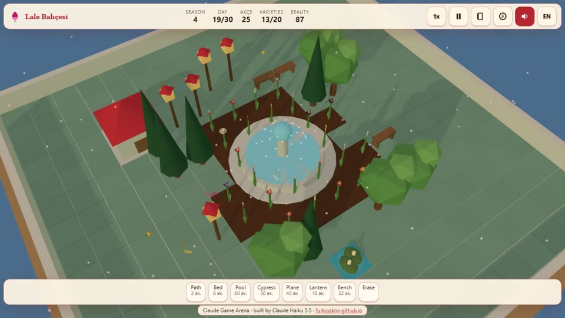
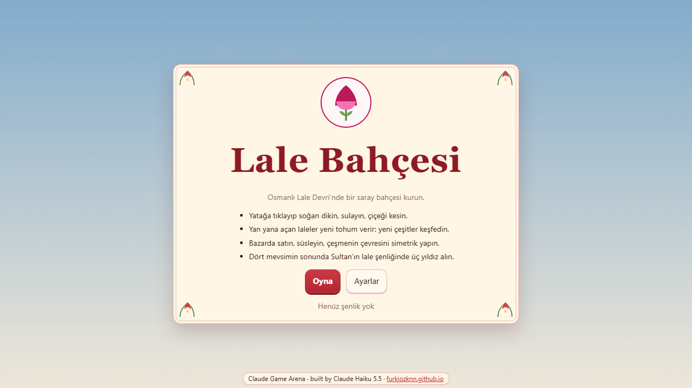
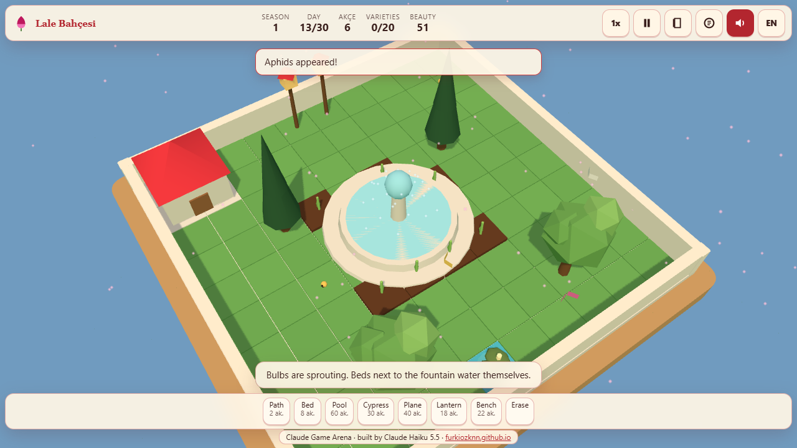
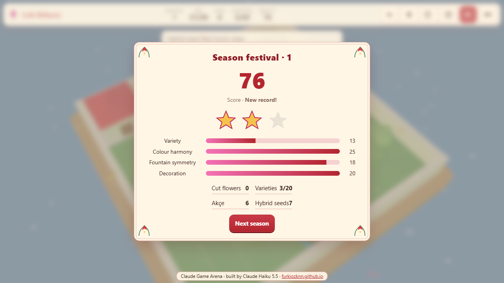
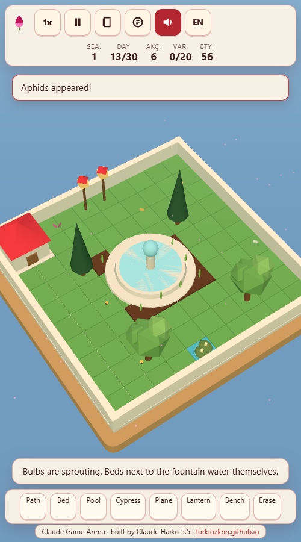
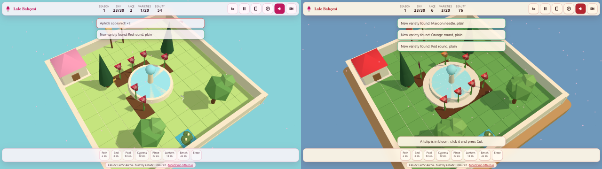

<p align="center">
  <a href="https://furkiozknn.github.io/lale-bahcesi/">
    
  </a>
</p>

<p align="center">
  <a href="https://furkiozknn.github.io/lale-bahcesi/"></a>
</p>

<p align="center">
  
  
  <a href="LICENSE"></a>
  
</p>

<!-- portals:start -->
<p align="center">
  Also on: <a href="https://furkiozknn.itch.io/lale-bahcesi"><strong>itch.io</strong></a>
</p>
<!-- portals:end -->

<p align="center">
  <strong>A cosy 3D garden builder set in the Ottoman Tulip Era: plant tulip bulbs on a walled palace terrace by the Bosphorus, breed new varieties, sell at the bazaar and win the Sultan's tulip festival.</strong>
</p>

<!-- gameplay gif -->

## Features

- **Terrace garden expansion:** Build paths, beds, a turtle pool, cypress and plane trees, lanterns and benches; starting with 4 beds, the terrace grows every season from 10x10 to 16x16 tiles.
- **Tulip breeding & genetics:** Start with 6 bulbs and cross-pollinate blooming pairs on neighbouring tiles to discover hybrid seeds mixing 3 petal shapes (round, almond, needle-petalled lale-i rumi) and 3 patterns (plain, flamed, edged).
- **Dynamic bazaar & tulip mania:** Trade bulbs and cuts with 50 starting akçe; navigate shifting market prices and sudden tulip manias while managing aphids and seasonal frost alerts.
- **Seasonal festivals & Sultan's favour:** Each season spans 30 days and culminates in a royal festival scored on variety, colour harmony, fountain symmetry and decoration; win with 3 stars and 20 varieties.
- **Ultra-lean web performance:** A single `index.html` running Three.js r170 delivering 60 fps at 42–61 draw calls and 4.3k–4.9k triangles on Intel UHD 620 (budget ~150 calls), tested by an automated bot across all seasons with 0 JS errors.

## How to play

> [!TIP]
> **Goal:** Win the final festival with three stars and at least 20 tulip varieties. Endless mode continues afterwards.

1. **Plant and water:** You start with 6 bulbs and 50 akçe. Click a bed tile to select it, plant a bulb from the list, water it (from the tile panel, or let the fountain's range do it) and wait for the bud.
2. **Cut and harvest:** Cut blooming tulips with **Cut** to sell blooms, and lift bulbs afterwards with **Lift bulb** to expand your stock or breed hybrids.
3. **Tend and protect:** Clean aphids from infected tulips before they spread, and heed frost warnings the day before cold snaps to protect young bulbs.

<details>
<summary><b>Moves and rules</b></summary>

- **Hybrid breeding:** Two blooming tulips on neighbouring tiles can breed a hybrid seed; new varieties go into the catalogue (`C`).
- **Bazaar & tulip mania:** Sell bulbs and flowers at the bazaar (`B`) and buy bulb packs there. Prices rise and crash, especially during a tulip mania.
- **Garden construction:** Build paths, beds, a pool with turtles, cypress and plane trees, lanterns and benches from the build bar; the erase tool removes them.
- **Pests & weather:** Aphids can appear on a tulip (clean them from the tile panel), and a frost warning comes the day before a frost that can damage young bulbs.
- **Scoring & seasons:** Each season lasts 30 days and ends with a festival scored on variety, colour harmony, fountain symmetry and decoration. The garden grows at the start of each new season (from 10x10 to 16x16 tiles).

</details>

### Controls

| Action | Mouse / touch | Keyboard |
|---|---|---|
| Select a tile, plant, water, cut | click a bed tile, then the tile panel | |
| Place or erase with a build tool | click or drag | `Q` / `E` rotate a decoration |
| Pan | drag (no build tool selected) | |
| Turn the camera / zoom | wheel / pinch to zoom | `Left` / `Right` turn, `Up` / `Down` zoom |
| Catalogue / bazaar | HUD buttons | `C` / `B` |
| Speed 1x / 2x / 4x | speed button | `T` |
| Pause / back | pause button | `P` / `Esc` |
| Music / effects / language | HUD buttons | `M` / `X` / `L` |
| Fullscreen | settings | `F` |

- **Global hotkeys:** `P` / `Esc` pause, `M` music, `X` effects, `L` language, `T` game speed, `F` fullscreen, `C` catalogue, `B` bazaar, `Q` / `E` rotate decoration.
- **Audio control:** The speaker button (top right on every screen) mutes music and effects together and is remembered.
- **Touch:** Tap bed tiles or HUD icons directly; drag to pan the terrace, pinch to zoom.
- **Persistence:** Settings are saved in `localStorage` under `arena.lale-bahcesi.settings`; the garden under `arena.lale-bahcesi.save`, and the best festival score under `arena.lale-bahcesi.best`. Turkish is the default language; phones start on the Low tier.

<details>
<summary><b>URL flags for testing</b></summary>

| Flag | Effect |
|---|---|
| `?auto` | The built-in bot plays the whole game with the same actions a player can take |
| `?debug` | FPS, draw calls, triangles and JS errors on screen |
| `?sim=N` | Fast-forward N game seconds before the first frame |
| `?low` | Shadows off, low quality tier |
| `?lang=en` / `?lang=tr` | Start language |

`window.lale` and `window.laleSim(seconds)` expose the state and fast-forward controls for automated tests.

</details>

## Screenshots

<table>
  <tr>
    <td width="50%"><br><sub>Title screen</sub></td>
    <td width="50%"><br><sub>Tulips around the fountain</sub></td>
  </tr>
  <tr>
    <td><br><sub>Season festival score</sub></td>
    <td><br><sub>On a phone</sub></td>
  </tr>
</table>

## Redesign & Performance

**Art direction:** A sunlit sandstone diorama floating on the Bosphorus: tulip red `#E63946`, pink `#F4A6C1`, marble `#EDEAE2`, lawn green `#6FB35F` (tinted per season), and sea blue `#6CA0DC`. The UI uses parchment garden-scroll panels with tulip-flourish corners.

**Visual updates (gameplay, bot, saves, and flags are untouched):**
- **Scene:** Sandstone diorama plinth and raised beds; tiered cypress and plane trees, capped lanterns, and a stepped fountain with animated spray, floating bees, and flickering lantern glow.
- **First minute:** The garden starts with 4 beds and a one-line coach, so the first bulb can be planted at once.
- **UI:** Parchment garden-scroll panels on every screen, responsive one-row phone HUD, and seasonal lawn tinting.

**Measured on an Intel UHD 620 (1280x720, `?auto` test run):**
- Draw calls: 42 &rarr; 57 (day 12) and 44 &rarr; 61 (day 22), well under the ~150-call budget
- Triangles: 4.3k &rarr; 4.9k (day 12)
- Page rAF: 60 fps sustained
- Bot verification: 0 JS errors across all seasons through the end festival screen; loads no external asset files (no separate `?noassets` run needed)



## Running locally

Serve the folder over HTTP (ES modules do not load from `file://`):

```bash
python -m http.server 8000
```

Then open <http://localhost:8000/>.

## Made with Claude Code

Built by **Claude Haiku 5.5** with Claude Code from one prompt: [prompts/lale-bahcesi.md](prompts/lale-bahcesi.md). No third-party assets are used; Three.js is loaded from jsDelivr under its MIT licence.

<details>
<summary><b>Technical notes</b></summary>

- **Procedural geometry:** Three.js procedural geometry models the sandstone terrace, stepped fountain, tulips (stems, leaves, dynamic petal geometries), cypress, planes, pool with turtles, lanterns, and benches.
- **Tulip genetics & catalogue:** Bulb genetics combine petal shape (round, almond, needle-petalled lale-i rumi), patterns (plain, flamed, edged), and colours. Hybrid seeds generate dynamically from adjacent blooming pairs and persist into the catalogue.
- **Audio synthesis (Web Audio):** Custom procedural sound effects and Ottoman-inspired ambient melodies synthesised in real time via the Web Audio API without audio sample files.
- **Rendering & visual effects:** MeshLambert and MeshStandard materials, directional sun lighting with dynamic shadows, fountain water spray, ambient floating bees, and seasonal colour transitions.
- **Zero asset loading:** A single self-contained `index.html` file requiring no external textures or models.

</details>

### Claude Game Arena

Lale Bahçesi is part of the **Claude Game Arena** series, where each game is built by a Claude model from one prompt.

[Hisar](https://furkiozknn.github.io/kale-savunmasi/) &middot; [Çay Ocağı](https://furkiozknn.github.io/cay-ocagi/) &middot; [Çini Ustası](https://furkiozknn.github.io/cini-ustasi/) &middot; [Martı](https://furkiozknn.github.io/marti/) &middot; [Kervan](https://furkiozknn.github.io/kervan/) &middot; [Dolmuş](https://furkiozknn.github.io/dolmus/) &middot; [Peri Golf](https://furkiozknn.github.io/peri-golf/) &middot; [Mehter](https://furkiozknn.github.io/mehter/) &middot; [Boğaz Vapuru](https://furkiozknn.github.io/bogaz-vapuru/) &middot; [Simit Fırını](https://furkiozknn.github.io/simit-firini/) &middot; [Karagöz](https://furkiozknn.github.io/karagoz/)

**Round 5:** [Kapadokya Balonu](https://furkiozknn.github.io/kapadokya-balonu/) &middot; [Ebru](https://furkiozknn.github.io/ebru/) &middot; [Kırkpınar](https://furkiozknn.github.io/kirkpinar/) &middot; [Çarşı Kaçışı](https://furkiozknn.github.io/carsi-kacisi/)

**Round 6:** [Topkapı Gecesi](https://furkiozknn.github.io/topkapi-gecesi/) &middot; [Hamsi](https://furkiozknn.github.io/hamsi/) &middot; [Pamukkale](https://furkiozknn.github.io/pamukkale/) &middot; [Mimar Sinan](https://furkiozknn.github.io/mimar-sinan/)

## License

MIT, see [LICENSE](LICENSE).

Like the game? You can support new rounds on [Buy Me a Coffee](https://buymeacoffee.com/furkiozkann). The game stays free.
