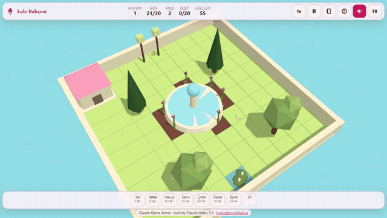
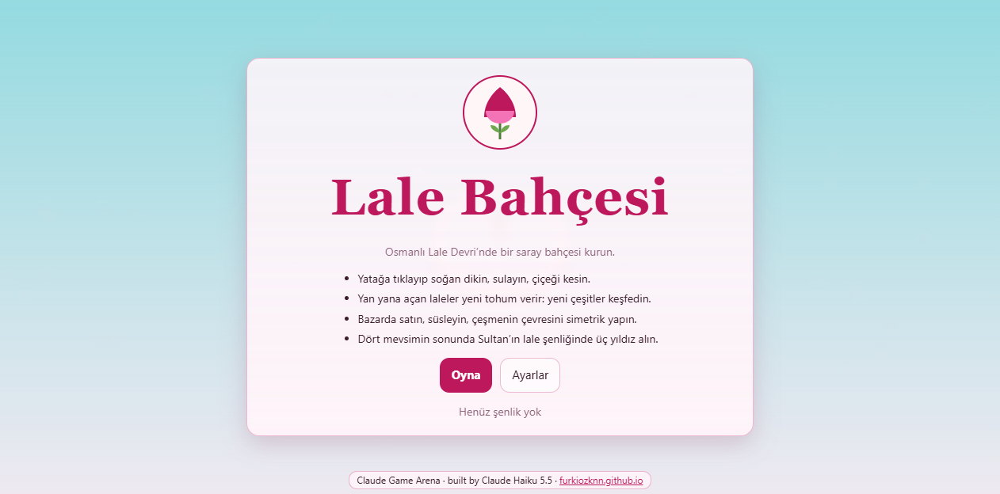
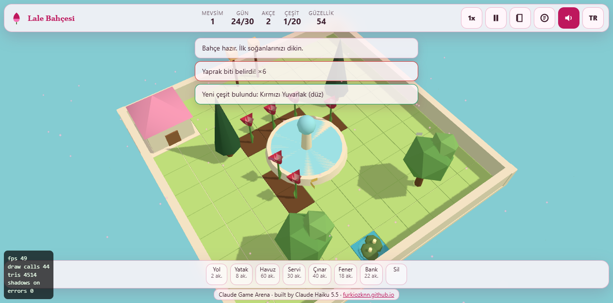
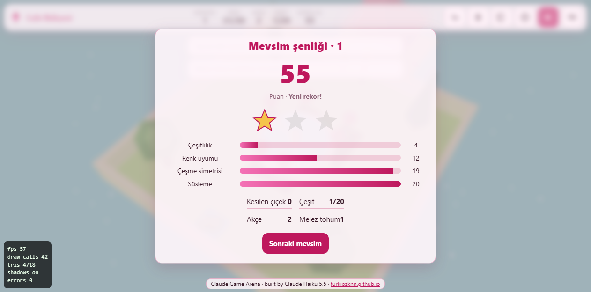
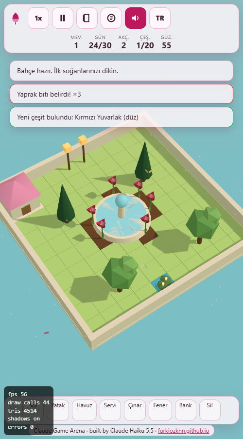

<p align="center">
  <a href="https://furkiozknn.github.io/lale-bahcesi/"></a>
</p>

<p align="center">
  <a href="https://furkiozknn.github.io/lale-bahcesi/"></a>
  
  
  <a href="LICENSE"></a>
  
</p>

<p align="center"><b>A cosy 3D garden builder set in the Ottoman Tulip Era: plant tulip bulbs on a walled palace terrace by the Bosphorus, breed new varieties, sell at the bazaar and win the Sultan's tulip festival.</b></p>

<p align="center">
  
</p>

<p align="center"><b>Play online: <a href="https://furkiozknn.github.io/lale-bahcesi/">https://furkiozknn.github.io/lale-bahcesi/</a></b> (desktop and phone, no install)</p>

<!-- portals:start -->
<p align="center">Also on: <a href="https://furkiozknn.itch.io/lale-bahcesi">itch.io</a></p>
<!-- portals:end -->

## Highlights

- **Plant, water, cut.** Plant bulbs in the beds, water them by hand or let the fountain do it, cut the blooms and lift
  the bulbs afterwards.
- **Breed new tulips.** Two blooming tulips on neighbouring tiles can make a hybrid seed that mixes the parents' colour,
  petal shape (round, almond or the needle-petalled lale-i rumi) and pattern (plain, flamed or edged).
- **A bazaar with a mania.** Sell bulbs and flowers and buy bulb packs; prices rise and crash, especially during a
  tulip mania.
- **Build the garden.** Paths, beds, a pool with turtles, cypress and plane trees, lanterns and benches; the garden grows
  every season, from 10x10 to 16x16 tiles.
- **Seasonal festivals.** At the end of each 30-day season the garden is scored on variety, colour harmony, fountain
  symmetry and decoration. Frost and aphids keep you on your toes.
- **One file, made in code.** One `index.html` with Three.js r170 from a CDN; geometry, the sprite and all sound are
  procedural, and no asset files are loaded.

## How to play

> [!TIP]
> **Goal:** win the final festival with three stars and at least 20 tulip varieties. Endless mode continues afterwards.

You start with 6 bulbs and 50 akçe. Click a bed tile to select it, plant a bulb from the list, water it (the tile
panel's Water button, or the fountain's range does it for you) and wait for the bud. Cut a blooming tulip with **Cut**
and lift the bulb afterwards with **Lift bulb**.

<details>
<summary><b>More rules</b></summary>

- Two blooming tulips on neighbouring tiles can breed a hybrid seed; new varieties go into the catalogue (`C`).
- Sell bulbs and flowers at the bazaar (`B`) and buy bulb packs there. Prices rise and crash, especially during a tulip
  mania.
- Build paths, beds, a pool with turtles, cypress and plane trees, lanterns and benches from the build bar; the erase
  tool removes them.
- Aphids can appear on a tulip (clean them from the tile panel), and a frost warning comes the day before a frost that
  can damage young bulbs.
- Each season lasts 30 days and ends with a festival scored on variety, colour harmony, fountain symmetry and
  decoration. The garden grows at the start of each new season.

</details>

### Controls

| Action | Mouse / touch | Keyboard |
|---|---|---|
| Select a tile, plant, water, cut | click a bed tile, then the tile panel | |
| Place or erase with a build tool | click or drag | `Q` / `E` rotate a decoration |
| Pan | drag (no build tool selected) | |
| Turn the camera / zoom | wheel / pinch to zoom | `Left` / `Right` turn, `Up` / `Down` zoom |
| Catalogue / bazaar | HUD buttons | `C` / `B` |
| Speed 1x / 2x / 4x | speed button | `T` |
| Pause / back | pause button | `P` / `Esc` |
| Music / effects / language | HUD buttons | `M` / `X` / `L` |
| Fullscreen | settings | `F` |

Settings are saved in `localStorage` under `arena.lale-bahcesi.settings`; the garden under `arena.lale-bahcesi.save`,
the best festival score under `arena.lale-bahcesi.best`. Turkish is the default language; phones start on the Low tier.

<details>
<summary><b>URL flags for testing</b></summary>

| Flag | Effect |
|---|---|
| `?auto` | the built-in bot plays the whole game with the same actions a player can take |
| `?debug` | fps, draw calls, triangles and JS errors on screen |
| `?sim=N` | fast-forward N game seconds before the first frame |
| `?low` | shadows off, low quality |
| `?lang=en` / `?lang=tr` | language |

`window.lale` and `window.laleSim(seconds)` expose the state and the fast-forward for tests.

</details>

## Screenshots

<table>
  <tr>
    <td width="50%"><br><sub>Title screen</sub></td>
    <td width="50%"><br><sub>Tulips around the fountain</sub></td>
  </tr>
  <tr>
    <td><br><sub>Season festival (Turkish UI)</sub></td>
    <td><br><sub>On a phone</sub></td>
  </tr>
</table>

## Running locally

Serve the folder over HTTP:

```
python -m http.server 8000
```

then open <http://localhost:8000/>.

## How it was made

Built by **Claude Haiku 5.5** with Claude Code from one prompt: [prompts/lale-bahcesi.md](prompts/lale-bahcesi.md). The
game is fully procedural: Three.js geometry for the terrace, the fountain, the tulips and the decorations, one Canvas
gradient sprite, and Web Audio synthesis for the music and sounds. Nothing is loaded except Three.js r170 from jsDelivr.

Lale Bahçesi is part of the **Claude Game Arena** series, where each game is built by a Claude model from one prompt.
The other games: [Hisar](https://furkiozknn.github.io/kale-savunmasi/) ·
[Çay Ocağı](https://furkiozknn.github.io/cay-ocagi/) · [Çini Ustası](https://furkiozknn.github.io/cini-ustasi/) ·
[Martı](https://furkiozknn.github.io/marti/) · [Kervan](https://furkiozknn.github.io/kervan/) ·
[Dolmuş](https://furkiozknn.github.io/dolmus/) · [Peri Golf](https://furkiozknn.github.io/peri-golf/) ·
[Mehter](https://furkiozknn.github.io/mehter/) · [Boğaz Vapuru](https://furkiozknn.github.io/bogaz-vapuru/) ·
[Simit Fırını](https://furkiozknn.github.io/simit-firini/) · [Karagöz](https://furkiozknn.github.io/karagoz/)

**Round 5:** [Kapadokya Balonu](https://furkiozknn.github.io/kapadokya-balonu/) ·
[Ebru](https://furkiozknn.github.io/ebru/) · [Kırkpınar](https://furkiozknn.github.io/kirkpinar/) ·
[Çarşı Kaçışı](https://furkiozknn.github.io/carsi-kacisi/)

**Round 6:** [Topkapı Gecesi](https://furkiozknn.github.io/topkapi-gecesi/) ·
[Hamsi](https://furkiozknn.github.io/hamsi/) · [Pamukkale](https://furkiozknn.github.io/pamukkale/) ·
[Mimar Sinan](https://furkiozknn.github.io/mimar-sinan/)

## Türkçe

**Lale Bahçesi**, Lale Devri'nde Boğaz kıyısındaki bir saray terasında geçen sakin bir 3D bahçe kurma oyunu. Lale
soğanlarını dik ve sula, yan yana açan laleleri melezleyip yeni çeşitler bul, pazarda sat ve bahçeni yollar, havuz,
selviler ve fenerlerle süsle. Son şenliği üç yıldız ve en az 20 çeşitle kazan. Kurulum yok; masaüstünde ve telefonda
tarayıcıda oynanır. Claude Haiku 5.5 tarafından Claude Code ile tek bir prompt'tan yapıldı.

**Oyna:** https://furkiozknn.github.io/lale-bahcesi/

## License

MIT, see [LICENSE](LICENSE).

Like the game? You can support new rounds on [Buy Me a Coffee](https://buymeacoffee.com/furkiozkann). The game stays free.
